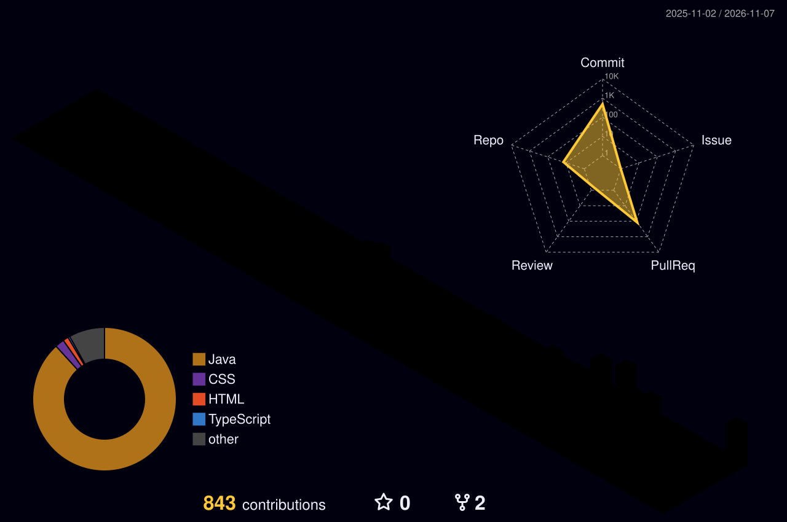

**日本語** · [한국어](README.md)

# こんにちは、チョン・ソヌです 👋

## 自己紹介 (About Me)

- 🎓 全南大学校 人工知能学部 在学中
- 📊 データ・機械学習分野に興味あり
- 🧩 原理から一歩ずつ理解する学習スタイル
- 🤝 チームプロジェクトではバックエンド開発とサービス企画の提案を担当、ムードメーカー
- 🇯🇵 JLPT N2
- 🦁 LIKELION バックエンドスクール 24 期（Java）修了
- 📜 情報処理技師、SQLD, ADSP

## アクティビティ (Contributions)

## 技術スタック (Tech Stack)

**Languages**

  
  
  

**Backend**

  
  
  

**Frontend**

  
  

**Infra / DevOps**

  
  
  
  
  
  

**Tools**

  
  

